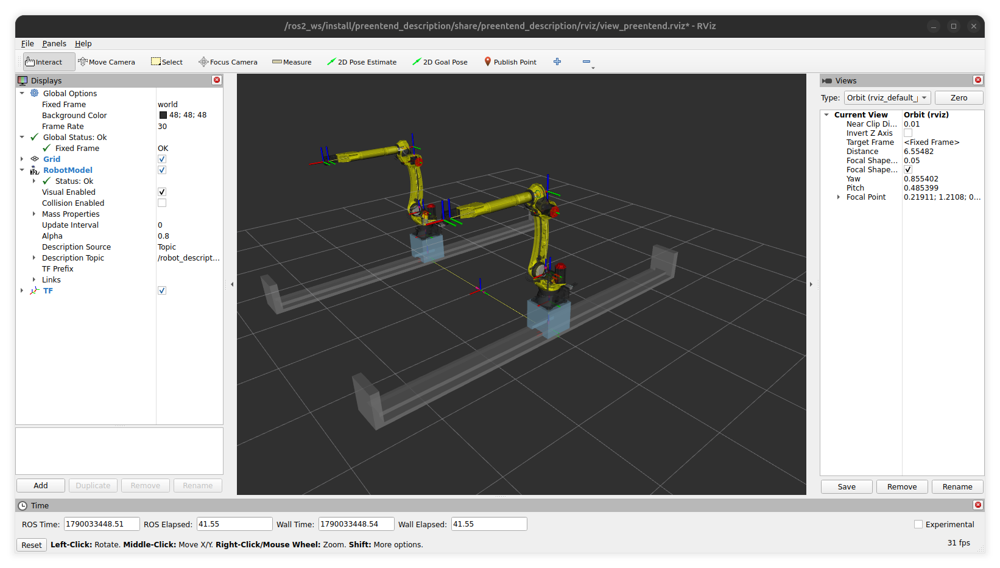
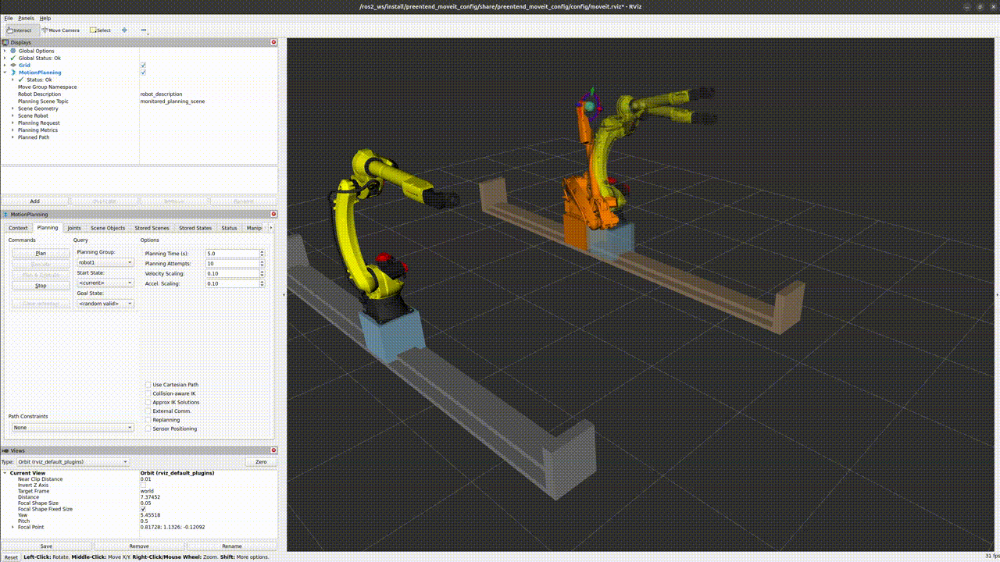

# Пакеты ROS 2

Подробное описание пакетов рабочего пространства `workspaces/ros2_ws`: что лежит в каждом пакете, какие launch-файлы и аргументы он предоставляет, какие топики публикует и как его расширять. Настройка окружения, запуск контейнера и сборка описаны в основном [README](../README.md).

Все команды выполняются **в контейнере ROS 2** после сборки и `source /ros2_ws/install/setup.bash`.

## Содержание

- [Обзор](#обзор)
- [preentend_description](#preentend_description)
- [preentend_controller](#preentend_controller)
- [preentend_gazebo](#preentend_gazebo)
- [preentend_moveit_config](#preentend_moveit_config)
- [gazebo_cars](#gazebo_cars)
- [Типичные задачи](#типичные-задачи)
- [Решение проблем](#решение-проблем)

## Обзор

| Пакет | Назначение | Зависит от |
| --- | --- | --- |
| [`preentend_description`](#preentend_description) | Xacro/URDF модели, меши, публикация `robot_description`, просмотр в RViz | — |
| [`preentend_controller`](#preentend_controller) | Конфигурация `ros2_control` и запуск контроллеров | `preentend_description` |
| [`preentend_gazebo`](#preentend_gazebo) | Мир Gazebo, создание модели, мосты Gazebo ↔ ROS, облака точек камер | — (робот берётся из топика `robot_description`) |
| [`preentend_moveit_config`](#preentend_moveit_config) | SRDF, кинематика, планирование MoveIt, итоговые сценарии запуска | все пакеты выше |
| [`gazebo_cars`](#gazebo_cars) | Статичные модели машин, их создание и удаление в запущенном Gazebo | — |

### Соглашение об именах launch-файлов

- Файлы **без** подчёркивания (`preentend_rviz2_display.launch.py`, `preentend_moveit_fake.launch.py`, `preentend_moveit_gazebo.launch.py`) — готовые сценарии, их запускают через `ros2 launch`.
- Файлы **с** подчёркиванием (`_robot_description.launch.py`, `_ros2_control.launch.py`, `_gazebo.launch.py`, `_moveit_common.launch.py`) — вспомогательные части, которые подключаются из сценариев через `IncludeLaunchDescription`. По отдельности они обычно не работают: им нужны узлы из других частей.

### Состав сценариев

```
preentend_rviz2_display.launch.py          (preentend_description)
├── _robot_joint_state.launch.py
│   ├── _robot_description.launch.py       robot_state_publisher
│   └── joint_state_publisher
└── _rviz2.launch.py                       RViz (display.rviz)

preentend_moveit_fake.launch.py            (preentend_moveit_config)
├── _ros2_control.launch.py                hardware_plugin = mock_components/GenericSystem
│   ├── _robot_description.launch.py       robot_state_publisher
│   ├── ros2_control_node
│   └── спаунеры: joint_state_broadcaster → left_arm_controller → right_arm_controller
└── _moveit_common.launch.py               move_group + MoveIt RViz, use_sim_time = false

preentend_moveit_gazebo.launch.py          (preentend_moveit_config)
├── _gazebo.launch.py                      (preentend_gazebo)
│   ├── Gazebo с миром worlds/empty.sdf
│   ├── create: модель из топика robot_description
│   ├── мост /clock
│   ├── мост топиков камер
│   └── depth_image_proc: облака точек камер
├── _ros2_control.launch.py                hardware_plugin = gz_ros2_control/GazeboSimSystem
│   ├── _robot_description.launch.py       robot_state_publisher (use_gazebo, use_sim_time)
│   └── спаунеры: joint_state_broadcaster → left_arm_controller → right_arm_controller
└── _moveit_common.launch.py               move_group + MoveIt RViz, use_sim_time = true
```

В Gazebo `controller_manager` запускается не отдельным узлом, а плагином `gz_ros2_control`, который подключается в URDF.

---

## preentend_description

Описание робота: две одинаковые руки (`left_` и `right_`), каждая стоит на своей линейной оси и несёт рабочий инструмент и камеру Intel RealSense D435.

### Структура

```
preentend_description/
├── robot/preentend.urdf.xacro       точка входа: сборка всего робота
├── urdf/
│   ├── robot_macro.xacro            макрос одной руки: ось + манипулятор + инструмент + камера
│   ├── common/                      материалы и макросы простых звеньев (link_box, link_cylinder)
│   ├── linear_axis/mock*.xacro      линейная ось (геометрия, gazebo, transmission, ros2_control)
│   ├── robot/m20_12_23d*.xacro      манипулятор M20-12-23D (геометрия, gazebo, transmission, ros2_control)
│   ├── end_effector/mock*.xacro     рабочий инструмент
│   └── camera/realsense*.xacro      камера RealSense D435 и её сенсоры для Gazebo
├── meshes/                          STL-меши манипулятора и инструмента
├── launch/                          публикация описания и просмотр в RViz
└── rviz/display.rviz                конфигурация RViz для просмотра модели
```

### Модель робота

[`robot/preentend.urdf.xacro`](../workspaces/ros2_ws/src/preentend_description/robot/preentend.urdf.xacro) создаёт звенья `world` → `base_link` и вызывает макрос `robot` дважды:

| Рука | Префикс | Положение относительно `base_link` |
| --- | --- | --- |
| Левая | `left_` | `y = +separation / 2` |
| Правая | `right_` | `y = -separation / 2` |

Аргументы xacro:

| Аргумент | По умолчанию | Назначение |
| --- | --- | --- |
| `separation` | `3.5` | Расстояние между осями рук по Y, м |
| `use_gazebo` | `false` | Добавить теги `<gazebo>`: сенсоры камер, `selfCollide` |
| `use_ros2_control` | `false` | Добавить теги `<ros2_control>` и `<transmission>` |
| `hardware_plugin` | `mock_components/GenericSystem` | Плагин оборудования `ros2_control`. При `gz_ros2_control/GazeboSimSystem` вместе с `use_gazebo` и `use_ros2_control` в модель добавляется плагин `gz_ros2_control`, который загружает [`ros2_controllers.yaml`](../workspaces/ros2_ws/src/preentend_controller/config/ros2_controllers.yaml) |

Посмотреть итоговый URDF без запуска:

```shell
xacro $(ros2 pkg prefix preentend_description)/share/preentend_description/robot/preentend.urdf.xacro \
  use_gazebo:=true use_ros2_control:=true hardware_plugin:=gz_ros2_control/GazeboSimSystem > /tmp/preentend.urdf
check_urdf /tmp/preentend.urdf
```

### Макрос руки `robot`

[`urdf/robot_macro.xacro`](../workspaces/ros2_ws/src/preentend_description/urdf/robot_macro.xacro) собирает одну руку из четырёх модулей. Модель каждого модуля выбирается параметром макроса, а файл подключается по имени `urdf/<модуль>/<модель>_macro.xacro`:

| Параметр | По умолчанию | Файл | Крепится к |
| --- | --- | --- | --- |
| `linear_axis_model` | `mock` | `urdf/linear_axis/mock_macro.xacro` | `parent` (с блоком `origin`) |
| `robot_model` | `m20_12_23d` | `urdf/robot/m20_12_23d_macro.xacro` | `<prefix>linear_axis_carrier_mount` |
| `end_effector_model` | `mock` | `urdf/end_effector/mock_macro.xacro` | `<prefix>flange` |
| `camera_model` | `realsense` | `urdf/camera/realsense_macro.xacro` | `<prefix>flange`, смещение `xyz="0.226 0 0.431"` |

Чтобы добавить новую модель модуля, создайте файл `urdf/<модуль>/<модель>_macro.xacro` с макросом того же имени (`linear_axis`, `robot_arm`, `end_effector`, `camera`) и теми же параметрами, затем передайте имя модели в макрос `robot`.

### Линейная ось `mock`

[`urdf/linear_axis/mock_macro.xacro`](../workspaces/ros2_ws/src/preentend_description/urdf/linear_axis/mock_macro.xacro) — рельс и каретка из параллелепипедов.

| Параметр | По умолчанию | Назначение |
| --- | --- | --- |
| `rail_length`, `rail_width`, `rail_height` | `6`, `0.4`, `0.16` | Размеры рельса, м |
| `carrier_length`, `carrier_width`, `carrier_height` | `0.4`, `0.4`, `0.4` | Размеры каретки, м |
| `effort_limit`, `velocity_limit` | `5000`, `0.5` | Ограничения сустава, Н и м/с |
| `material` | `dark_gray` | Материал из `common/materials.xacro` |

Призматический сустав `<prefix>linear_axis_joint` двигает каретку вдоль X в пределах `±(rail_length − carrier_length) / 2`, то есть ±2.8 м при значениях по умолчанию. Манипулятор крепится к `<prefix>linear_axis_carrier_mount` на верхней грани каретки.

### Манипулятор M20-12-23D

[`urdf/robot/m20_12_23d.urdf.xacro`](../workspaces/ros2_ws/src/preentend_description/urdf/robot/m20_12_23d.urdf.xacro) — шестиосевой манипулятор с суставами `<prefix>J1` … `<prefix>J6` и звеньями `<prefix>base_link`, `<prefix>J1_link` … `<prefix>J6_link`. Пределы суставов заданы свойствами в начале файла:

| Сустав | Диапазон, ° | Скорость, °/с |
| --- | --- | --- |
| J1 | −185 … 185 | 210 |
| J2 | −100 … 160 | 210 |
| J3 | −90 … 220 | 265 |
| J4 | −200 … 200 | 420 |
| J5 | −180 … 180 | 450 |
| J6 | −450 … 450 | 720 |

Фланец `<prefix>flange` смещён на 0.075 м по X от `<prefix>J6_link`. К нему крепятся инструмент и камера.

### Инструмент `mock`

[`urdf/end_effector/mock_macro.xacro`](../workspaces/ros2_ws/src/preentend_description/urdf/end_effector/mock_macro.xacro) — звено `<prefix>end_effector_link` с отдельными мешами для визуализации (`meshes/mock_end_effector/visual`) и столкновений (`meshes/mock_end_effector/collision`). Рабочая точка инструмента — фрейм `<prefix>tcp` (`xyz="0.236 0 0.155"` от звена инструмента).

### Камера RealSense D435

[`urdf/camera/realsense_macro.xacro`](../workspaces/ros2_ws/src/preentend_description/urdf/camera/realsense_macro.xacro) повторяет геометрию и фреймы официального `realsense2_description`, поэтому дерево TF совпадает с тем, что публикует драйвер `realsense2_camera` на реальной камере.

Параметры макроса `camera`:

| Параметр | По умолчанию | Назначение |
| --- | --- | --- |
| `prefix` | `''` | Префикс имён фреймов |
| `parent` | — | Звено, к которому крепится камера |
| `*origin` | — | Положение крепёжного винта камеры относительно `parent` |
| `use_gazebo` | `false` | Добавить сенсоры Gazebo |
| `enable_infra` | `false` | Добавить ИК-камеры `infra1`/`infra2` в Gazebo |

Фреймы:

| Фрейм | Описание |
| --- | --- |
| `<prefix>camera_bottom_screw_frame` | Крепёжный винт на нижней грани корпуса. Сюда приходит `origin` из макроса |
| `<prefix>camera_link` | Начало отсчёта глубины: левый ИК-сенсор на плоскости нулевой глубины |
| `<prefix>camera_depth_frame` | Глубина, совпадает с `camera_link` |
| `<prefix>camera_infra1_frame` | Левая ИК-камера, `y = 0` |
| `<prefix>camera_infra2_frame` | Правая ИК-камера, `y = −0.050` (стереобаза 50 мм) |
| `<prefix>camera_color_frame` | Цветная камера, `y = +0.015` |
| `<prefix>camera_*_optical_frame` | Оптический фрейм для каждого сенсора выше |

Фреймы `*_frame` ориентированы как обычные фреймы ROS: X вперёд, Z вверх. Фреймы `*_optical_frame` — по конвенции камер: Z вперёд, X вправо, Y вниз. Поэтому в RViz оптические фреймы выглядят повёрнутыми относительно остального робота, это ожидаемо. Изображения и облака точек привязаны к оптическим фреймам, а TF сам выполняет преобразование.

#### Сенсоры камеры в Gazebo

[`urdf/camera/realsense.gazebo.xacro`](../workspaces/ros2_ws/src/preentend_description/urdf/camera/realsense.gazebo.xacro) задаёт сенсоры по даташиту D435. Разрешения — профили 16:9 (для них верны углы обзора из даташита) с размерами по умолчанию драйвера `realsense2_camera`:

| Сенсор | Тип | Разрешение | Гор. угол обзора | Дальность | Формат |
| --- | --- | --- | --- | --- | --- |
| depth | `depth_camera` | 848×480 | 87° | 0.28–10 м | 32FC1, метры |
| color | `camera` | 1280×720 | 69° | — | RGB8 |
| infra1, infra2 (при `enable_infra`) | `camera` | 848×480 | 87° | — | mono8 |

- Частота всех сенсоров задаётся свойством `fps` в начале файла, сейчас 15 Гц.
- Каждый сенсор подписывает сообщения своим оптическим фреймом через `<gz_frame_id>`.
- Сенсоры работают только при подключённой к миру системе `gz::sim::systems::Sensors`. В мире [`preentend_gazebo/worlds/empty.sdf`](../workspaces/ros2_ws/src/preentend_gazebo/worlds/empty.sdf) она есть.

> **Производительность.** Gazebo рендерит все камеры внутри шага симуляции, поэтому каждая камера замедляет симуляционное время. Если коэффициент реального времени (RTF) падает, сначала снизьте `fps`, затем разрешение. ИК-камеры по умолчанию выключены по той же причине.

> **Комментарии в xacro.** Комментарии внутри макросов попадают в итоговый URDF. Launch-файлы передают `robot_description` как строку (`ParameterValue(..., value_type=str)`), поэтому любые символы в комментариях безопасны. Если будете писать новый launch-файл с `Command(["xacro ..."])`, используйте тот же приём.

### Launch-файлы

#### `preentend_rviz2_display.launch.py` — просмотр модели

```shell
ros2 launch preentend_description preentend_rviz2_display.launch.py
```

Запускает `robot_state_publisher`, `joint_state_publisher` и RViz с конфигурацией [`rviz/display.rviz`](../workspaces/ros2_ws/src/preentend_description/rviz/display.rviz) (фиксированный фрейм `world`). Контроллеры и MoveIt не запускаются. `joint_state_publisher` работает без GUI и публикует начальные положения суставов.



#### `_robot_description.launch.py`

Генерирует URDF через xacro и запускает `robot_state_publisher`, который публикует `/robot_description` и TF.

| Аргумент | По умолчанию | Назначение |
| --- | --- | --- |
| `use_sim_time` | `false` | Использовать время из `/clock` |
| `use_gazebo` | `false` | Передаётся в xacro |
| `use_ros2_control` | `false` | Передаётся в xacro |
| `hardware_plugin` | `mock_components/GenericSystem` | Передаётся в xacro, допустимы `mock_components/GenericSystem` и `gz_ros2_control/GazeboSimSystem` |

#### `_robot_joint_state.launch.py`

`_robot_description.launch.py` плюс `joint_state_publisher`. Аргументы: `use_sim_time`, `use_gazebo`, `use_ros2_control`.

#### `_rviz2.launch.py`

RViz с аргументами `use_sim_time` и `rviz2_params` (путь к файлу `.rviz`, по умолчанию `rviz/display.rviz`).

---

## preentend_controller

Конфигурация `ros2_control` для обеих рук и запуск контроллеров. Один и тот же launch-файл работает и с mock-оборудованием, и с Gazebo.

### Структура

```
preentend_controller/
├── config/ros2_controllers.yaml     controller_manager и контроллеры
└── launch/_ros2_control.launch.py   описание робота + controller_manager + спаунеры
```

### Интерфейсы оборудования

Интерфейсы описаны в URDF (подключаются при `use_ros2_control:=true`):

| Система `ros2_control` | Суставы | Команды | Состояния |
| --- | --- | --- | --- |
| `<prefix>linear_axis` | `<prefix>linear_axis_joint` | position, velocity | position, velocity, effort |
| `<prefix>m20_12_23d` | `<prefix>J1` … `<prefix>J6` | position, velocity | position, velocity |

### Контроллеры

[`config/ros2_controllers.yaml`](../workspaces/ros2_ws/src/preentend_controller/config/ros2_controllers.yaml), `controller_manager` работает с частотой 100 Гц и ограничивает команды пределами суставов (`enforce_command_limits: true`).

| Контроллер | Тип | Суставы | Action |
| --- | --- | --- | --- |
| `joint_state_broadcaster` | `JointStateBroadcaster` | все | — (публикует `/joint_states`) |
| `left_arm_controller` | `JointTrajectoryController` | `left_linear_axis_joint`, `left_J1` … `left_J6` | `/left_arm_controller/follow_joint_trajectory` |
| `right_arm_controller` | `JointTrajectoryController` | `right_linear_axis_joint`, `right_J1` … `right_J6` | `/right_arm_controller/follow_joint_trajectory` |

Каждый контроллер траекторий управляет линейной осью и манипулятором вместе, как одной кинематической цепью из 7 суставов. Допуски: 0.01 рад (или м) в конце движения, 1.0 вдоль траектории, `goal_time: 0.5` с.

### `_ros2_control.launch.py`

| Аргумент | По умолчанию | Допустимые значения |
| --- | --- | --- |
| `hardware_plugin` | `mock_components/GenericSystem` | `mock_components/GenericSystem`, `gz_ros2_control/GazeboSimSystem` |

Что запускается:

1. `_robot_description.launch.py` с `use_ros2_control:=true`. Для `gz_ros2_control/GazeboSimSystem` также включаются `use_gazebo` и `use_sim_time`.
2. Только для `mock_components/GenericSystem`: `ros2_control_node`. В Gazebo `controller_manager` поднимает плагин `gz_ros2_control`.
3. Спаунеры по очереди: `joint_state_broadcaster` → `left_arm_controller` → `right_arm_controller`. Каждый следующий стартует после завершения предыдущего, спаунер ждёт `controller_manager` до 120 с.

Сам по себе этот файл можно запустить с mock-оборудованием, чтобы проверить контроллеры без MoveIt:

```shell
ros2 launch preentend_controller _ros2_control.launch.py
ros2 control list_controllers
```

С `gz_ros2_control/GazeboSimSystem` нужен ещё запущенный Gazebo с моделью, поэтому для симуляции используйте `preentend_moveit_gazebo.launch.py`.

### Отправка траектории без MoveIt

```shell
ros2 action send_goal /left_arm_controller/follow_joint_trajectory control_msgs/action/FollowJointTrajectory "{
  trajectory: {
    joint_names: [left_linear_axis_joint, left_J1, left_J2, left_J3, left_J4, left_J5, left_J6],
    points: [{positions: [0.5, 0.3, 0.2, 0.0, 0.0, 0.0, 0.0], time_from_start: {sec: 3}}]
  }
}"
```

---

## preentend_gazebo

Симуляция в Gazebo (gz sim, ROS 2 Jazzy): мир, создание модели робота, мосты Gazebo ↔ ROS и облака точек камер.

### Структура

```
preentend_gazebo/
├── worlds/empty.sdf             пустой мир с системами физики и сенсоров
└── launch/_gazebo.launch.py     Gazebo + создание робота + мосты + облака точек
```

### Мир `empty.sdf`

[`worlds/empty.sdf`](../workspaces/ros2_ws/src/preentend_gazebo/worlds/empty.sdf) — мир с именем `empty`, плоскостью земли и направленным светом. Шаг физики 1 мс, целевой RTF 1.0. Подключённые системы:

| Система | Назначение |
| --- | --- |
| `Physics` | Физика |
| `UserCommands` | Создание и удаление моделей, в том числе через `ros_gz_sim create` |
| `SceneBroadcaster` | Передача сцены в GUI Gazebo |
| `Contact` | Контакты |
| `Sensors` (`ogre2`) | Рендеринг камер. Без неё топики камер существуют, но пустые |

Системы уровня мира подключаются здесь, а не в URDF. В URDF остаются только плагины, привязанные к модели, например `gz_ros2_control`.

### `_gazebo.launch.py`

| Аргумент | По умолчанию | Назначение |
| --- | --- | --- |
| `world` | `<share>/preentend_gazebo/worlds/empty.sdf` | Путь к файлу мира |

Что запускается:

| Узел | Назначение |
| --- | --- |
| `gz_sim.launch.py` из `ros_gz_sim` | Gazebo с аргументами `-r -v 2 <world>`: симуляция сразу запущена |
| `ros_gz_sim create` | Создаёт модель `preentend` из топика `/robot_description`, мир определяется автоматически |
| `parameter_bridge` (часы) | `/clock` из Gazebo в ROS |
| `parameter_bridge` (камеры) | Топики камер из Gazebo в ROS |
| `depth_image_proc/point_cloud_xyz_node` ×2 | Облака точек `left_` и `right_` камер |

> `create` берёт модель из топика `/robot_description`, поэтому рядом должен работать `robot_state_publisher` с `use_gazebo:=true`. В `preentend_moveit_gazebo.launch.py` его запускает `_ros2_control.launch.py`. Если запустить `_gazebo.launch.py` отдельно, Gazebo откроется, но робот не появится, пока описание не будет опубликовано.

`preentend_moveit_gazebo.launch.py` использует мир по умолчанию. Чтобы взять другой мир, поменяйте значение `world` в `_gazebo.launch.py` или передайте аргумент `world` в `IncludeLaunchDescription` в `preentend_moveit_gazebo.launch.py`.

Собственный мир должен содержать систему `Sensors`, иначе камеры не будут публиковать данные.

### Топики камер

Мост работает в одну сторону, из Gazebo в ROS, с `lazy: true`: данные передаются только когда у топика есть подписчик в ROS. Для каждого префикса `left_` и `right_`:

| Топик ROS | Тип | Фрейм |
| --- | --- | --- |
| `/<prefix>camera/depth/image_rect_raw` | `sensor_msgs/Image` (32FC1, м) | `<prefix>camera_depth_optical_frame` |
| `/<prefix>camera/depth/camera_info` | `sensor_msgs/CameraInfo` | `<prefix>camera_depth_optical_frame` |
| `/<prefix>camera/depth/points` | `sensor_msgs/PointCloud2` | `<prefix>camera_depth_optical_frame` |
| `/<prefix>camera/color/image_raw` | `sensor_msgs/Image` (RGB8) | `<prefix>camera_color_optical_frame` |
| `/<prefix>camera/color/camera_info` | `sensor_msgs/CameraInfo` | `<prefix>camera_color_optical_frame` |
| `/<prefix>camera/infra{1,2}/image_rect_raw` | `sensor_msgs/Image` (mono8) | `<prefix>camera_infra{1,2}_optical_frame` |
| `/<prefix>camera/infra{1,2}/camera_info` | `sensor_msgs/CameraInfo` | `<prefix>camera_infra{1,2}_optical_frame` |

ИК-топики появляются только при `enable_infra:=true` в макросе камеры.

**Почему облако точек строится через `depth_image_proc`.** Сенсор `depth_camera` в Gazebo сам публикует облако на `<topic>/points`, но считает точки во фрейме тела (X вперёд), а подписывает их оптическим фреймом. Из-за этого облако в RViz повёрнуто: пол выглядит стеной. Поэтому облако этого сенсора не передаётся в ROS, а `point_cloud_xyz_node` строит его из изображения глубины и `camera_info`. Так же облако получается и на реальной камере.

Префиксы камер заданы в `_gazebo.launch.py` кортежем `camera_prefixes = ("left_", "right_")`. При добавлении или переименовании рук обновите его.

Проверка:

```shell
ros2 topic hz /left_camera/depth/points
ros2 topic echo /left_camera/color/camera_info --once
gz topic -l | grep camera          # топики на стороне Gazebo
```

---

## preentend_moveit_config

Конфигурация MoveIt 2 и итоговые сценарии запуска. Пакет создан MoveIt Setup Assistant и доработан вручную.

### Структура

```
preentend_moveit_config/
├── srdf/preentend.srdf                 группы планирования и исключения столкновений
├── config/
│   ├── kinematics.yaml                 решатели обратной кинематики
│   ├── joint_limits.yaml               скорости и ускорения для планирования
│   ├── ompl_planning.yaml              планировщики OMPL и адаптеры запросов
│   ├── moveit_controllers.yaml         связь MoveIt с контроллерами
│   └── pilz_cartesian_limits.yaml      пределы для планировщика Pilz (не подключён)
├── launch/
│   ├── preentend_moveit_fake.launch.py     MoveIt + mock-оборудование
│   ├── preentend_moveit_gazebo.launch.py   MoveIt + Gazebo
│   ├── _moveit_common.launch.py            move_group + RViz
│   └── setup_assistant.launch.py           MoveIt Setup Assistant
├── rviz/moveit.rviz
└── .setup_assistant
```

### Группы планирования

Все группы — цепочки от общего `base_link`, поэтому в каждую входит линейная ось и шесть суставов манипулятора (7 степеней свободы). Группы одной руки отличаются только конечным звеном:

| Группа | Конечное звено | Когда использовать |
| --- | --- | --- |
| `left_arm_flange` / `right_arm_flange` | `<prefix>flange` | Цели для фланца |
| `left_arm_tcp` / `right_arm_tcp` | `<prefix>tcp` | Цели для рабочей точки инструмента |
| `left_arm_camera` / `right_arm_camera` | `<prefix>camera_link` | Наведение камеры |

Для всех групп используется решатель KDL (`kinematics.yaml`) и планировщик OMPL `RRTConnect` по умолчанию (`ompl_planning.yaml`).

SRDF также содержит исключения проверки самостолкновений, сгенерированные Setup Assistant. После изменения геометрии (новый инструмент, перенос камеры) их стоит перегенерировать, см. [Перенастройка через Setup Assistant](#перенастройка-через-setup-assistant).

### Ограничения и контроллеры

- [`joint_limits.yaml`](../workspaces/ros2_ws/src/preentend_moveit_config/config/joint_limits.yaml) задаёт максимальные скорости (как в URDF) и ускорение 1.0 для всех суставов. Масштаб скорости и ускорения по умолчанию 1.0, в RViz его можно уменьшить в панели Planning.
- [`moveit_controllers.yaml`](../workspaces/ros2_ws/src/preentend_moveit_config/config/moveit_controllers.yaml) связывает MoveIt с `left_arm_controller` и `right_arm_controller` через `FollowJointTrajectory`. Траектория группы отправляется контроллеру, который управляет её суставами.
- [`ompl_planning.yaml`](../workspaces/ros2_ws/src/preentend_moveit_config/config/ompl_planning.yaml) включает адаптеры: проверка начального состояния, тайм-параметризация (`AddTimeOptimalParameterization`) и проверка решения.

### Launch-файлы

#### `preentend_moveit_fake.launch.py` — MoveIt без симуляции

```shell
ros2 launch preentend_moveit_config preentend_moveit_fake.launch.py
```

`_ros2_control.launch.py` с `mock_components/GenericSystem` и `_moveit_common.launch.py` с `use_sim_time:=false`. Контроллеры сразу «выполняют» команды без физики. Подходит для проверки планирования и групп.

#### `preentend_moveit_gazebo.launch.py` — MoveIt с Gazebo

```shell
ros2 launch preentend_moveit_config preentend_moveit_gazebo.launch.py
```

`_gazebo.launch.py`, `_ros2_control.launch.py` с `gz_ros2_control/GazeboSimSystem` и `_moveit_common.launch.py` с `use_sim_time:=true`. Все узлы работают по симуляционному времени из `/clock`.



#### `_moveit_common.launch.py`

Собирает конфигурацию через `MoveItConfigsBuilder("preentend")` с конвейером `ompl` и запускает `move_group` и RViz.

| Аргумент | По умолчанию | Назначение |
| --- | --- | --- |
| `use_sim_time` | `false` | Время из `/clock` |
| `use_rviz` | `true` | Запускать RViz |
| `rviz_config` | `rviz/moveit.rviz` | Конфигурация RViz |

#### `setup_assistant.launch.py`

```shell
ros2 launch preentend_moveit_config setup_assistant.launch.py
```

### Перенастройка через Setup Assistant

1. Запустите `setup_assistant.launch.py` и загрузите существующий пакет `preentend_moveit_config`.
2. Внесите изменения: группы, матрица столкновений и т. д.
3. Сохраните конфигурацию.
4. Проверьте файлы, которые Setup Assistant мог перезаписать, через `git diff`. Launch-файлы, `moveit_controllers.yaml` и `ompl_planning.yaml` в этом пакете доработаны вручную, ненужные изменения в них лучше откатить.

---

## gazebo_cars

Статичные модели машин для сцен в Gazebo и launch-файл, который добавляет выбранную машину в уже запущенный мир.

### Структура

```
gazebo_cars/
├── models/car_*/
│   ├── model.sdf                модель: меш + коллизия-параллелепипед
│   ├── model.config
│   └── meshes/*.dae
├── launch/spawn_car.launch.py   создание машины в запущенном Gazebo
└── launch/remove_car.launch.py  удаление машины из запущенного Gazebo
```

Пакет объявляет `<gazebo_ros gazebo_model_path="${prefix}/models" />` в `package.xml`. `ros_gz_sim` добавляет этот путь в `GZ_SIM_RESOURCE_PATH` при запуске Gazebo, поэтому адреса `model://car_*` работают без дополнительной настройки окружения. Машины можно подключать и в своих мирах через `<include><uri>model://car_golf</uri></include>`.

### Модели

Все модели приведены к одному виду:

- машина отцентрована в начале координат модели и стоит колёсами на `z = 0`;
- длина машины направлена вдоль X. Куда смотрит перед (+X или −X), зависит от исходного меша;
- коллизия — параллелепипед по габаритам меша;
- модели статичные (`<static>true</static>`), на них не действует физика.

| Модель | Габариты Д × Ш × В, м |
| --- | --- |
| `car_008` | 4.59 × 2.00 × 1.59 |
| `car_012` | 3.79 × 1.60 × 1.13 |
| `car_018` | 3.87 × 1.73 × 1.24 |
| `car_019` | 4.04 × 2.01 × 1.31 |
| `car_046` | 4.31 × 2.03 × 1.65 |
| `car_121` | 4.27 × 1.83 × 1.64 |
| `car_144` | 4.89 × 2.19 × 1.90 |
| `car_158` | 2.62 × 1.28 × 0.91 |
| `car_199` | 5.73 × 2.36 × 2.22 |
| `car_beetle` | 3.35 × 1.55 × 1.43 |
| `car_golf` | 4.21 × 1.96 × 1.50 |
| `car_lexus` | 3.78 × 1.76 × 1.36 |
| `car_opel` | 4.55 × 2.13 × 1.52 |
| `car_polo` | 4.04 × 1.97 × 1.67 |
| `car_volvo` | 4.97 × 2.33 × 1.76 |

Габариты включают зеркала. Меши заданы в дюймах (`<unit meter="0.0254">` в DAE), Gazebo переводит их в метры сам. Множители `<scale>` в некоторых `model.sdf` достались от исходных моделей и нужны, чтобы получить реальный размер.

> Часть DAE ссылается на файлы текстур, которых нет в пакете. При загрузке Gazebo пишет `Unable to find texture [...]`. Это не мешает: такие детали отображаются цветом материала.

### `spawn_car.launch.py`

Создаёт машину в уже запущенном Gazebo, мир определяется автоматически.

```shell
ros2 launch gazebo_cars spawn_car.launch.py car:=car_lexus x:=0.0 y:=0.0 yaw:=1.57
```

| Аргумент | По умолчанию | Назначение |
| --- | --- | --- |
| `car` | `car_golf` | Модель, одна из папок `models/` |
| `name` | значение `car` | Имя объекта в мире, должно быть уникальным |
| `x`, `y`, `z` | `0.0` | Положение, м |
| `yaw` | `0.0` | Поворот вокруг Z, рад |

Чтобы поставить две одинаковые машины, задайте разные `name`:

```shell
ros2 launch gazebo_cars spawn_car.launch.py car:=car_golf name:=golf_1 x:=-2.0
ros2 launch gazebo_cars spawn_car.launch.py car:=car_golf name:=golf_2 x:=3.0
```

Список доступных моделей: `ros2 launch gazebo_cars spawn_car.launch.py --show-args`.

### `remove_car.launch.py`

Удаляет машину из запущенного Gazebo по имени объекта, мир определяется автоматически.

```shell
ros2 launch gazebo_cars remove_car.launch.py name:=car_lexus
```

| Аргумент | По умолчанию | Назначение |
| --- | --- | --- |
| `name` | обязательный | Имя объекта: `name` из `spawn_car.launch.py`, по умолчанию совпадает с моделью |

> Gazebo отвечает `Entity removal successful` даже тогда, когда объекта с таким именем нет. Проверить, что осталось в мире: `gz model --list`.

---

## Типичные задачи

### Изменить положение камеры

Отредактируйте блок `<origin>` у вызова `xacro:camera` в [`urdf/robot_macro.xacro`](../workspaces/ros2_ws/src/preentend_description/urdf/robot_macro.xacro). Это положение крепёжного винта камеры относительно `<prefix>flange`. Пересборка не нужна при `--symlink-install`, достаточно перезапустить сценарий. Если камера сдвинулась заметно, перегенерируйте исключения столкновений в SRDF.

### Включить ИК-камеры в Gazebo

Передайте `enable_infra="true"` в вызов `xacro:camera` в `robot_macro.xacro`. Мост для ИК-топиков уже настроен.

### Изменить частоту или разрешение камер

Свойства `fps`, `cam_depth_width`/`cam_depth_height`, `cam_color_width`/`cam_color_height` в начале [`realsense.gazebo.xacro`](../workspaces/ros2_ws/src/preentend_description/urdf/camera/realsense.gazebo.xacro). Используйте профили 16:9, иначе вертикальный угол обзора не совпадёт с реальной камерой.

### Изменить расстояние между руками

Аргумент xacro `separation` в [`preentend.urdf.xacro`](../workspaces/ros2_ws/src/preentend_description/robot/preentend.urdf.xacro), по умолчанию 3.5 м.

### Добавить контроллер

1. Опишите его в [`ros2_controllers.yaml`](../workspaces/ros2_ws/src/preentend_controller/config/ros2_controllers.yaml): тип в секции `controller_manager` и параметры в отдельной секции.
2. Добавьте спаунер в `_ros2_control.launch.py`.
3. Если им должен управлять MoveIt, добавьте его в [`moveit_controllers.yaml`](../workspaces/ros2_ws/src/preentend_moveit_config/config/moveit_controllers.yaml).

---

## Решение проблем

| Симптом | Причина и решение |
| --- | --- |
| `Unable to parse the value of parameter robot_description as yaml` | Значение `robot_description` передано без `ParameterValue(..., value_type=str)`, и `launch_ros` пытается разобрать URDF как YAML. Обычно срабатывает на комментарии с `: `. Оберните `Command(...)` в `ParameterValue` |
| Топики камер в Gazebo есть, но пустые | В мире нет системы `gz::sim::systems::Sensors`. Используйте `worlds/empty.sdf` или добавьте систему в свой мир |
| Облако точек повёрнуто, пол выглядит стеной | Используется облако из `depth_camera` Gazebo, а не из `depth_image_proc`. См. [Топики камер](#топики-камер) |
| Робот в Gazebo двигается очень медленно, RTF низкий | Рендеринг камер замедляет шаг симуляции. Проверьте, что Gazebo использует дискретную видеокарту (`nvidia-smi` на хосте должен показывать процесс `gz sim`; контейнер `ros2` запускается с `runtime: nvidia`), затем снизьте `fps` и разрешение камер |
| Спаунеры контроллеров завершаются с ошибкой по тайм-ауту | `controller_manager` не поднялся. В Gazebo проверьте, что модель создалась и в логе есть сообщения `gz_ros2_control`. URDF должен генерироваться с `use_gazebo:=true use_ros2_control:=true hardware_plugin:=gz_ros2_control/GazeboSimSystem` |
| MoveIt не выполняет план: `Unable to identify any set of controllers` | Контроллеры ещё не активны или их суставы не совпадают с `moveit_controllers.yaml`. Проверьте `ros2 control list_controllers` |
